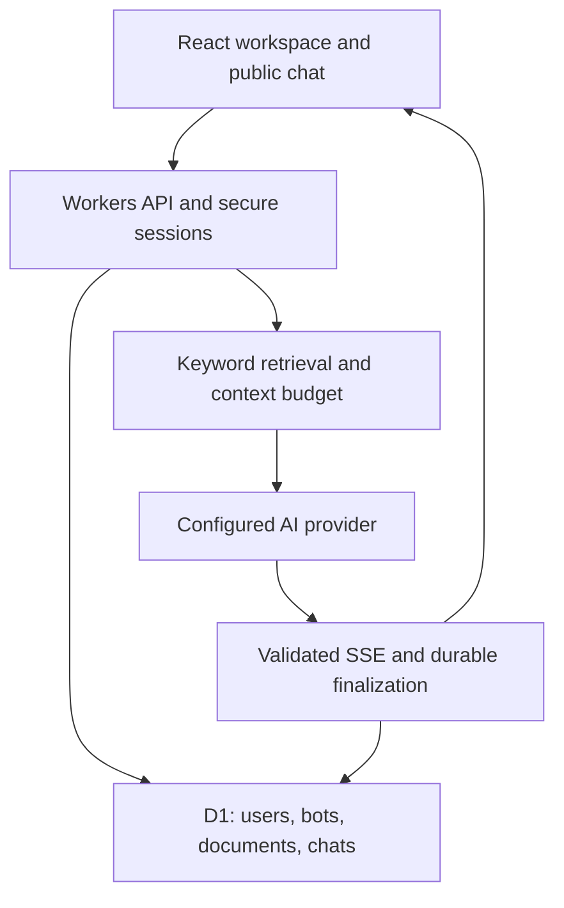

# ShadowBot architecture

ShadowBot is an original SHADOWNET application, catalogue #86. It uses React 19 and TypeScript, Vinext routing, Cloudflare Workers, and Cloudflare D1. The first release deliberately uses bounded keyword retrieval instead of an embedding/vector pipeline.

## Application boundaries

- `app/shadowbot.tsx`: workspace navigation, chat state, streaming UI, and conversation loading. No API keys or security decisions live here.
- `components/shadowbot/`: reusable dialogs, account form, assistant editor, source rendering. React escapes all model and document text; raw HTML is never rendered. Markdown support is deliberately limited to bold, inline code, code blocks, and preserved line breaks.
- `build/sites-worker.ts`: retained Sites/Vinext request adapter, intercepting `/api/*` before framework rendering. It preserves the Sites build integration and adds application security headers.
- `server/api.ts`: authentication, ownership checks, D1 queries, bounded uploads, rate limits, chat leases, and stream persistence.
- `server/provider.ts`: OpenAI-compatible HTTP transport and memory selection. No provider SDK or tool execution is needed for this release. Redirects are handled manually so authorization is not forwarded to a new origin.
- `lib/rag.ts`: deterministic chunking and BM25-inspired keyword scoring. This is not a fully calibrated BM25 or semantic search implementation.
- `lib/sse.ts`: shared incremental UTF-8/SSE decoder with frame limits.
- `db/schema.ts` and `drizzle/`: typed schema and immutable generated migration SQL.
- `gateway/worker.mjs`: optional private Workers AI bridge used by the demo. It has an AI binding and a project-scoped secret. The application can instead use OpenRouter, OpenAI, xAI, or another compatible `/chat/completions` API.

## Data model and authorization

| Entity        | Purpose and access                                                  |
| ------------- | ------------------------------------------------------------------- |
| users         | Normalized unique email, display name, salted password hash         |
| sessions      | SHA-256 hash of a 256-bit opaque token, user ID, seven-day expiry   |
| bots          | Owner ID, description, system prompt, greeting, accent, public flag |
| documents     | Per-bot UTF-8 source, SHA-256 deduplication hash, size, chunk count |
| chunks        | Per-bot searchable excerpt with source document and position        |
| conversations | User ID, bot ID, title, update time, generation lease               |
| messages      | Role, text, retrieved sources, status, timestamps                   |
| rate_limits   | Atomic persistent counters for login, registration and chat quotas  |

Every protected operation checks the session on the server. Editing a bot or its documents additionally checks ownership. A bot being public grants chat access, not access to its owner's private system prompt, document management, or other people's messages. Each conversation belongs to the person chatting; a bot owner cannot read a visitor's conversation. Publishing exposes knowledge indirectly through answers and retrieved excerpts. Unpublishing revokes subsequent visitor history/chat reads; the visitor can still delete their own stored chat.

Conversation `bot_id` intentionally has no foreign key because the immutable `shadow-guide` sample is defined in source rather than inserted as migration data. Deleting a mutable bot explicitly removes all associated conversations in a batch. Other parent/child records use cascading foreign keys.

## Authentication and request protection

The app provides its own email/password registration and login, matching the open registration pattern in ShadowSocial. The Sites hosting access boundary is separate; the demo's site audience is public, while application write/history endpoints require an app session.

Passwords use PBKDF2-SHA-256 with independent random 128-bit salts, 100,000 iterations, and 256-bit output. Workers Web Crypto caps PBKDF2 iterations in the deployed runtime; this is weaker than current high-iteration password-hardening recommendations. Combined with rate limits and a 12-character minimum, it is an explicit v1 compromise. A managed identity provider or a suitably benchmarked memory-hard scheme is the next authentication improvement. Comparison avoids early returns over equal-length values. Session cookies are `__Host-`, HttpOnly, Secure, SameSite=Lax, path `/`. Only token hashes are stored in D1. Tokens are never put in browser storage. Logout deletes the server session. Expired sessions and quota rows are pruned after chat requests; inactivity alone does not trigger cleanup.

All state-changing endpoints require an exact same-origin `Origin` header and reject cross-site fetch metadata. There is no wildcard CORS. Inputs and request bytes are bounded; queries use bound parameters. Security headers disable object embedding, constrain sources, and prevent caching private responses. The framework needs inline hydration scripts; CSP currently permits inline scripts and styles rather than using nonces. No model tool calls, arbitrary server URLs, uploaded HTML execution, or source-document instruction execution is implemented.

## Chat lifecycle

1. Authenticate, validate input, check public/owner bot access, and apply rate limits.
2. Load or create the user's conversation and atomically acquire a 110-second generation lease. Concurrent requests to the same conversation return 409.
3. Reject repeated user message IDs and chats with 200 messages. Quotas count attempts that reach generation, including provider failures.
4. Select up to 20 complete recent messages within a 16,000-character history budget. Include the prior user question for follow-up keyword retrieval.
5. Rank up to 600 bot-isolated chunks, select at most four, and avoid adjacent duplicates from the same document. Assemble the custom system prompt, instruction/data boundaries, numbered reference excerpts, memory, and current question.
6. Save the user turn and a streaming assistant placeholder. Return an SSE `meta` event immediately, followed by `delta`, optional `error`, then `done`.
7. Limit the provider to 768 output tokens, 16,000 received characters, and a 90-second deadline. Propagate disconnects to the provider. Require a provider completion marker; a truncated stream is not success.
8. Persist text, sources, and terminal status, then release the lease before emitting `done`. Interrupted text is saved as failed/stopped and excluded from future assistant memory. If persistence fails, the client never receives a successful final event. A stale lease expires, and an unfinished row is shown as failed when loaded.

The stored source excerpts show context given to the model. They are not verified entailment citations. Prompt injection boundaries reduce risk but cannot guarantee that a probabilistic model ignores malicious reference text.

## Explicit v1 limits

20 bots/account, 100 conversations/account, 200 messages/chat, 4,000 characters/question, 6,000 characters/system prompt; 20 documents/bot, 50,000 UTF-8 bytes/document, 600 chunks/bot. Chunk target: 1,100 characters with 160-character overlap. Rate limits: 8 chat attempts/minute/account, 40 generation attempts/day/account, 200/day/service, 8 registrations/hour/IP, 30 login attempts/15 minutes/IP and 10/15 minutes/email. Daily windows use UTC. These are demo safeguards, not a billing meter or protection against coordinated distributed abuse.

D1 serializes writes and atomically increments quota/lease rows. The small corpus is loaded per request and scored in memory. Retrieval performs repeated document-frequency scans and should be replaced with indexed search for larger corpora. The first release is not benchmarked for high concurrent traffic or audited for security.

## Deployment and operations

Sites provisions D1 and applies schema-only Drizzle migrations before publishing the built Worker and assets. `.openai/hosting.json` declares logical bindings, never credentials. Server provider values are deployment secrets/config. The private AI gateway lives in the connected Cloudflare account with a native AI binding; a rotated gateway key must be updated in both deployments. The gateway accepts bounded messages and enforces its fixed model/token ceiling. It relies on the secret and the application's D1 quotas rather than providing another independent billing/quota system.

The app's compatibility date remains the starter-tested `2026-05-15` because the installed local Workerd binary cannot execute future dates. The separate gateway uses `2026-10-19`. Upgrade the hosting runtime and re-run the suites before advancing the application date. Structured logs contain event types and random request IDs; model contents and credentials are not intentionally logged. D1 backups, privacy requests, account lifecycle, security review, usage monitoring and gateway-secret rotation remain operator responsibilities.
